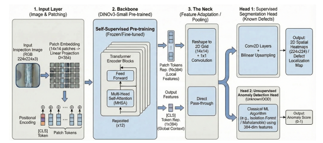
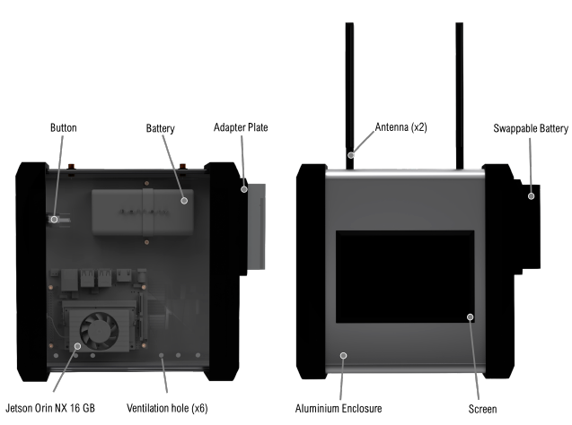
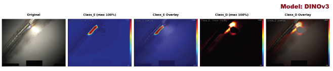

# AI-Enhanced Visual Inspection of Pharmaceutical Pipe Welds

An end-to-end computer vision and Edge AI solution automating the visual qualification of pharmaceutical pipe welds in compliance with strict GMP regulations.

Developed as a Master's Thesis project at the **Technical University of Denmark (DTU)** in collaboration with **Novo Nordisk Engineering (NNE)** and **HelixLab**.

---

## 📌 Overview

- **End-to-End Ownership:** Directed the full engineering lifecycle—from borescope video acquisition and color-space pre-screening to edge model deployment and XAI integration.
- **Two-Stage Inspection Pipeline:** 
  1. *High-Recall Pre-screening:* Automated candidate HAZ (Heat-Affected Zone) color extraction from raw video streams using OpenCV and CIELAB color-space thresholding.
  2. *Deep Learning Classification:* Multi-head architecture leveraging self-supervised Vision Transformers (DINO) and object detection models (YOLO/ResNet) for weld segmentation and unsupervised anomaly detection.
- **Explainable AI (XAI) for GMP Compliance:** Bridged AI decisions and strict pharmaceutical regulatory standards by integrating Grad-CAM and backbone attention heatmaps for auditable decision traceability.
- **Portable Edge Deployment:** Engineered and validated a standalone hardware prototype powered by an **NVIDIA Jetson Orin NX (16GB)** with an integrated touchscreen UI, enabling real-time on-site inspections directly on the facility floor.

---

## Tech Stack & Tools

- **Frameworks:** Python, PyTorch, OpenCV, TensorRT
- **Architectures:** Vision Transformers (DINO), YOLO, ResNet-18
- **Edge Hardware:** NVIDIA Jetson Orin NX 16GB, Touchscreen Display, Linux/JetPack
- **Explainability:** Grad-CAM, Attention Rollout maps

---

## System Architecture

---

## Portable Edge Prototype

---

## Explainability & Quality Validation (XAI)

---

## Confidentiality Notice

*Due to non-disclosure agreements (NDAs) and proprietary pharmaceutical manufacturing standards, raw inspection footage and proprietary datasets are omitted from this repository. Model architectures, evaluation methodologies, and edge pipeline scripts are provided for academic and portfolio demonstration.*
